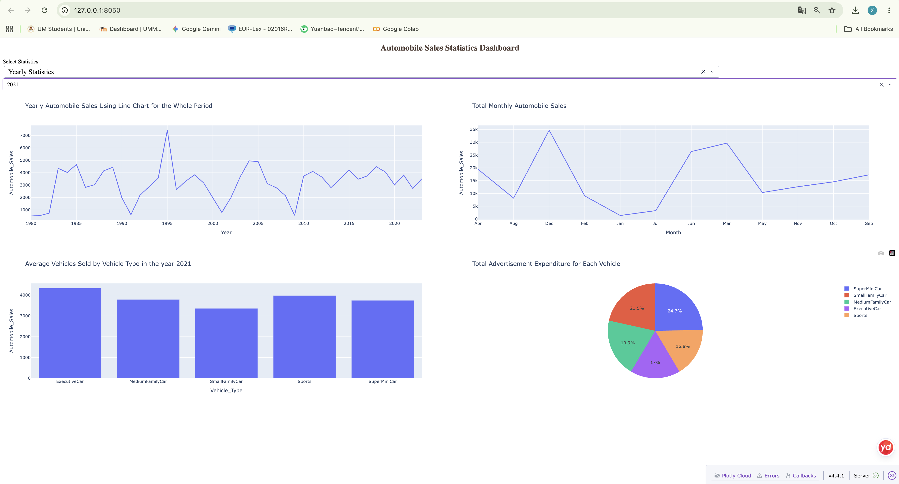

# WANG XIUTING

**Data Science & Compliance · University of Macau**

I am a master's student in Data Science and Compliance at the University of Macau, working at the intersection of applied data analysis, data visualisation, and regulatory thinking. I turn raw data into clear, decision-ready visuals — from exploratory notebooks to interactive dashboards — with an emphasis on honest and reproducible analysis.

---

## Technical Skills

| Area | Tools |
| --- | --- |
| Data analysis | Python, Pandas, NumPy, Scikit-learn |
| Visualisation | Matplotlib, Seaborn, Plotly, Dash, Folium |
| Version control & collaboration | Git / GitHub |

---

## Featured Project

### Automobile Sales During Recessions vs. Non-Recessions

**Research question:** How do automobile sales change during economic recessions compared with normal periods, and which macro-economic and marketing factors help explain those changes?

**Status:** Completed

An end-to-end analysis of the *XYZAutomotives* historical sales dataset (1980–2023), combining an exploratory notebook built with Matplotlib, Seaborn and Folium with an interactive Dash dashboard that lets a user switch between a whole-period yearly view and a recession-only view.

*Recession Period Statistics.* Average annual sales swing from roughly 500 units at recession troughs (around 1990, 2000 and 2009) to about 3,000 units near the peaks. During downturns the cheapest segment, SuperMiniCar, carries the highest volume, while ExecutiveCar and Sports drop to around 850 units — a clear trade-down effect. Advertising spend stays fairly evenly spread across all five segments (roughly 14%–25% each).

*Yearly Statistics (2021).* Across 1980–2023, average sales peak near 7,000 units around 1995 and dip during 1990–91, 2000–01 and 2009–10. Sales are strongly seasonal, climbing to a December peak (about 30,000 units) and bottoming out in the first half of the year. In the 2021 recovery year the mix reverses: ExecutiveCar leads at roughly 3,800 units, suggesting buyers trade back up as confidence returns.

*Limitation:* The dataset is a simulated historical teaching dataset (XYZAutomotives) and does not capture post-2023 EV market shifts.

**Stack:** Python · Pandas · NumPy · Matplotlib · Seaborn · Plotly · Dash · Folium

**Repository:** [github.com/wang-xiuting/data-science-project](https://github.com/wang-xiuting/data-science-project)

---

## Additional Coursework (Assignments 01 & 02)

Supporting coursework from CISC7204 – Data Science and Data Visualization, archived in the [data-science-project](https://github.com/wang-xiuting/data-science-project) repository alongside the featured project. Each folder contains the original notebooks, scripts, datasets, figures and project proposal, with a README describing the individual modules.

### Assignment 01 — Data Analysis with Python

Six modules covering the full analysis pipeline: importing datasets, data wrangling, exploratory data analysis, model development, and model evaluation and refinement. It concludes with a final project on King County house sales and a practice project on insurance-cost analysis.

**Topics:** Pandas · missing-value handling · standardisation & binning · descriptive statistics · Pearson correlation · linear and polynomial regression · cross-validation · ridge regression · grid search

**Browse the folder:** [assignment-01 on GitHub](https://github.com/wang-xiuting/data-science-project/tree/main/assignment-01)

### Assignment 02 — Data Visualization with Python

Five modules progressing from static charts to interactive dashboards: Matplotlib line, area, bar, pie, box, scatter and bubble plots; waffle charts, word clouds and regression plots; Folium geospatial maps; Plotly charts; and Dash applications with callbacks, including a flight-delay dashboard. The final module is the automobile-sales analysis that became the featured project above.

**Topics:** Matplotlib · Seaborn · Plotly · Dash · Folium · interactive callbacks · choropleth maps

**Browse the folder:** [assignment-02 on GitHub](https://github.com/wang-xiuting/data-science-project/tree/main/assignment-02)

---

*This portfolio is maintained for academic and professional demonstration purposes.*
