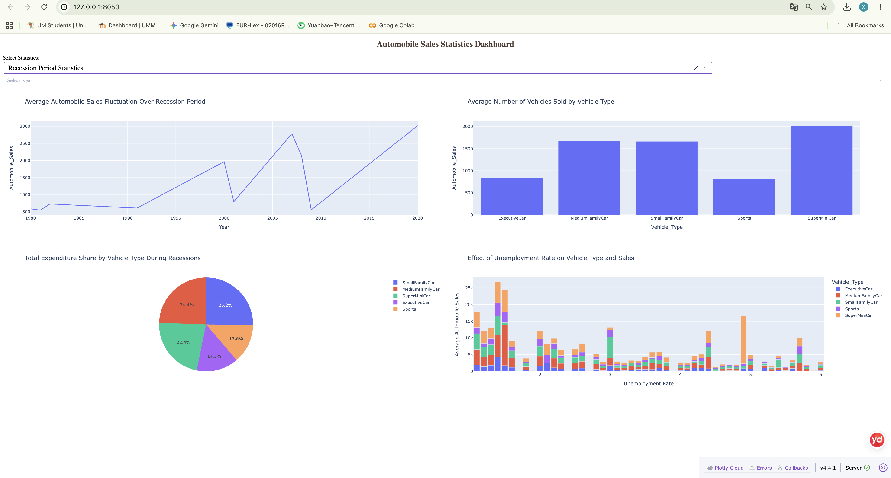

# WANG XIUTING

**Data Science & Compliance · University of Macau**

I am a master's student in Data Science and Compliance at the University of Macau, working at the intersection of applied data analysis, data visualisation, and regulatory thinking. I turn raw data into clear, decision-ready visuals — from exploratory notebooks to interactive dashboards — with an emphasis on honest and reproducible analysis.

---

## Technical Skills

| Area | Tools |
| --- | --- |
| Data analysis | Python, Pandas, NumPy, Scikit-learn |
| Visualisation | Matplotlib, Seaborn, Plotly, Dash, Folium |
| Version control & collaboration | Git / GitHub |

---

## Featured Project

### Automobile Sales During Recessions vs. Non-Recessions

**Research question:** How do automobile sales change during economic recessions compared with normal periods, and which macro-economic and marketing factors help explain those changes?

**Status:** Completed

An end-to-end analysis of the *XYZAutomotives* historical sales dataset (1980–2023), combining an exploratory notebook built with Matplotlib, Seaborn and Folium with an interactive Dash dashboard that lets a user switch between a whole-period yearly view and a recession-only view.

*Recession Period Statistics.* Average annual sales swing from roughly 500 units at recession troughs (around 1990, 2000 and 2009) to about 3,000 units near the peaks. During downturns the cheapest segment, SuperMiniCar, carries the highest volume, while ExecutiveCar and Sports drop to around 850 units — a clear trade-down effect. Advertising spend stays fairly evenly spread across all five segments (roughly 14%–25% each).

*Yearly Statistics (2021).* Across 1980–2023, average sales peak near 7,000 units around 1995 and dip during 1990–91, 2000–01 and 2009–10. Sales are strongly seasonal, climbing to a December peak (about 30,000 units) and bottoming out in the first half of the year. In the 2021 recovery year the mix reverses: ExecutiveCar leads at roughly 3,800 units, suggesting buyers trade back up as confidence returns.

**Stack:** Python · Pandas · NumPy · Matplotlib · Seaborn · Plotly · Dash · Folium

**Repository:** [github.com/wang-xiuting/data-science-project](https://github.com/wang-xiuting/data-science-project)

---

*This portfolio is maintained for academic and professional demonstration purposes.*
